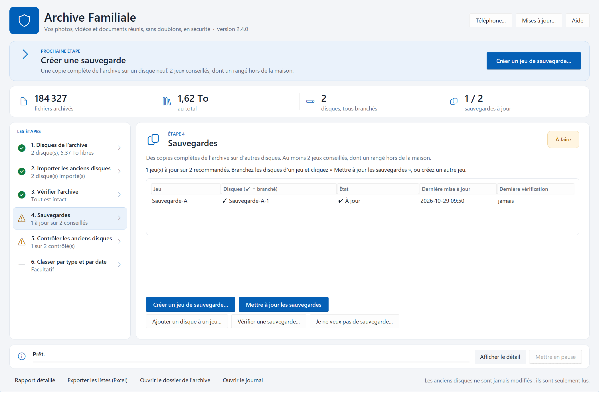
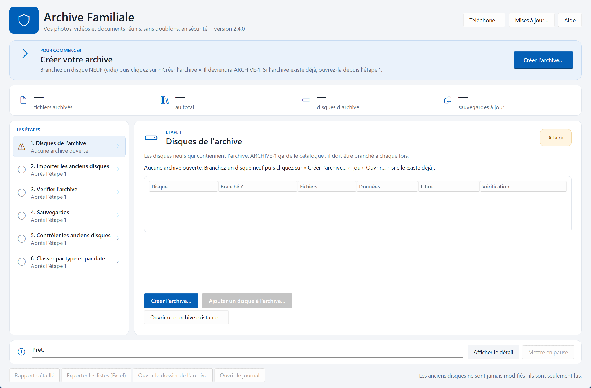
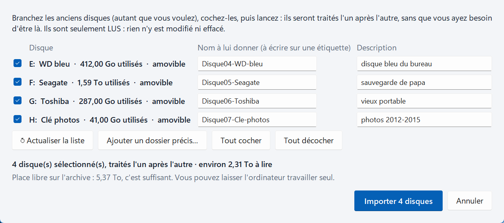
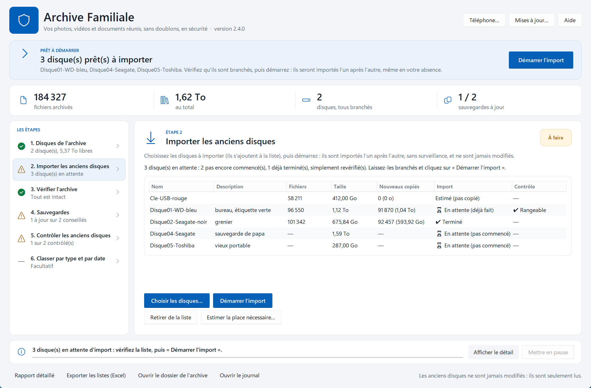
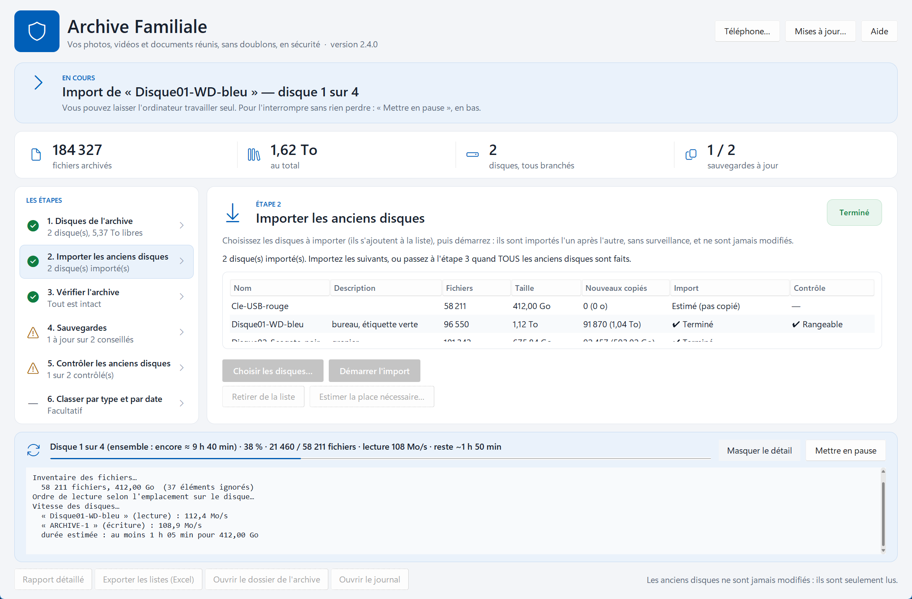
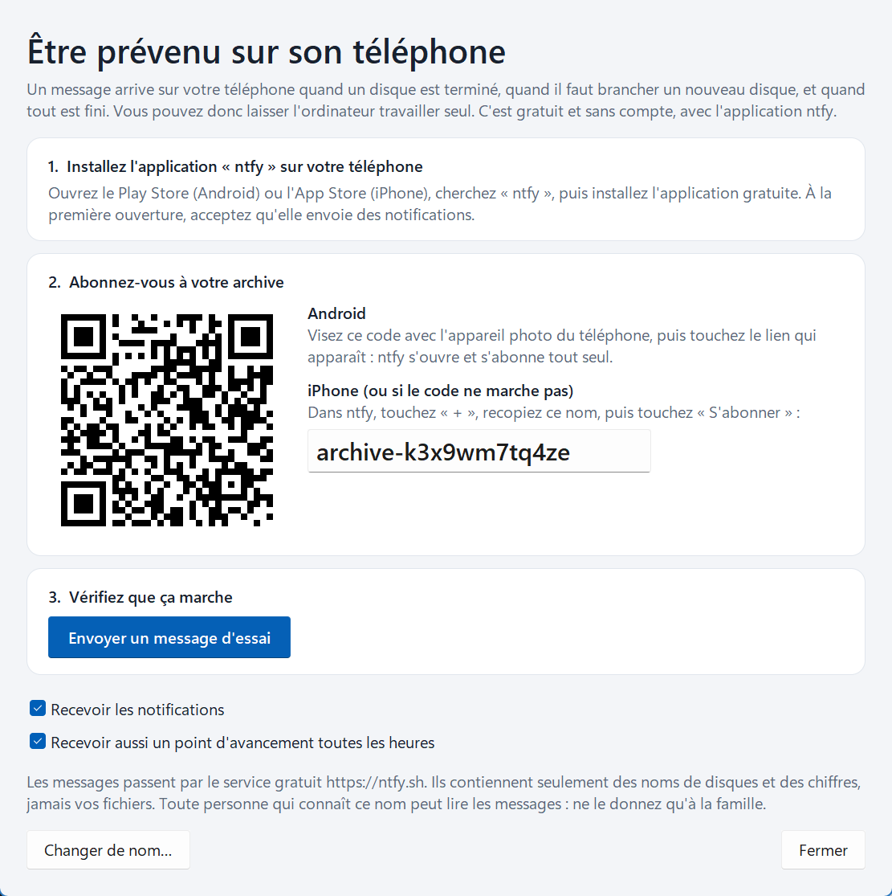

# Archive Familiale

**Toutes les photos, vidéos et documents de la famille, réunis au même endroit, sans doublons, et en sécurité.**

Vous avez des vieux disques durs, des clés USB, d'anciens ordinateurs pleins de souvenirs ?
Archive Familiale les rassemble en **une seule archive**, ne garde **qu'un exemplaire** de chaque
fichier, puis vous aide à en faire des **copies de sauvegarde**. Tout est vérifié, rien n'est jamais
effacé sur vos anciens disques.

---

## Pourquoi vous pouvez lui faire confiance

- 🔒 **Vos anciens disques ne sont jamais modifiés.** Le programme se contente de les lire.
- 🧬 **Chaque fichier est vérifié.** Le programme calcule une « empreinte » de chaque fichier
  (comme une empreinte digitale) et s'en sert pour vérifier que les copies sont parfaites.
- ♻️ **Pas de doublons.** Une même photo présente sur cinq disques n'est gardée qu'une fois, même
  si elle a changé de nom.
- ⏸️ **On peut tout arrêter et reprendre.** Coupure de courant, disque débranché, ordinateur éteint :
  relancez simplement, le programme reprend là où il en était.
- 📂 **Pas de format secret.** L'archive est faite de dossiers et de fichiers ordinaires, lisibles sur
  n'importe quel ordinateur, même sans ce programme.

---

## Installer le programme

1. Cliquez sur le bouton **Télécharger** ci-dessus (ou ouvrez
   [la page des versions](https://github.com/ElMastho/ArchiveFamiliale/releases/latest)).
2. Téléchargez **`ArchiveFamiliale-Setup.exe`**, puis double-cliquez dessus.
   L'installation ne demande pas de mot de passe administrateur.
3. Windows peut afficher « Windows a protégé votre ordinateur » : cliquez sur
   **Informations complémentaires**, puis **Exécuter quand même**. Ce message apparaît pour les
   programmes qui ne sont pas vendus dans le commerce ; il est normal.

Le programme s'ouvre depuis le menu Démarrer : **Archive Familiale**.

> 💡 Installez le programme **sur l'ordinateur**, pas sur les disques de l'archive.

**Mises à jour** : à chaque démarrage, le programme regarde s'il existe une nouvelle version et
propose de l'installer. Un clic suffit : il se ferme, se met à jour et se rouvre. Vos fichiers et vos
réglages ne sont pas touchés. (Si vous refusez, le bouton **« Installer la version … »** reste en
haut de la fenêtre.)

---

## Comment ça marche, en 5 étapes

Vous n'avez rien à retenir : en haut de la fenêtre, une carte bleue **« Prochaine étape »** vous dit
toujours quoi faire, avec un gros bouton pour le faire. À gauche, les étapes se cochent en vert au fur
et à mesure.

### Ce qu'il vous faut

- Un ou plusieurs **disques durs neufs** pour l'archive (assez grands pour tout contenir ; le
  programme vous aide à estimer la place nécessaire) ;
- idéalement **deux autres disques** pour les sauvegardes ;
- vos **anciens disques**, clés USB, cartes mémoire…
- des **étiquettes** (ou un feutre) pour noter le nom de chaque disque.

### Les étapes

| | Étape | Ce que vous faites |
|---|---|---|
| 1️⃣ | **Créer l'archive** | Branchez un disque **neuf** et cliquez sur « Créer l'archive ». Il devient `ARCHIVE-1`. S'il n'y a plus de place un jour, ajoutez un deuxième disque : `ARCHIVE-2`. |
| 2️⃣ | **Importer les anciens disques** | Branchez un ou **plusieurs** anciens disques, cliquez sur « Choisir les disques » et cochez-les : ils s'ajoutent à la liste, « en attente ». Puis cliquez sur **« Démarrer l'import »** : ils sont importés **l'un après l'autre**, même si vous partez. |
| 3️⃣ | **Vérifier l'archive** | Quand tout est importé, cliquez sur « Vérifier maintenant ». Le programme relit les fichiers et confirme que rien n'est abîmé (la fois suivante, il ne relit que les nouveaux). |
| 4️⃣ | **Faire des sauvegardes** | Branchez un autre disque neuf et cliquez sur « Créer un jeu de sauvegarde ». Faites-en **deux**, et rangez-en un **hors de la maison** (chez un proche, au travail…). |
| 5️⃣ | **Contrôler les anciens disques** | Un disque importé sans erreur est déjà contrôlé. Si vous l'avez modifié depuis, rebranchez-le et cliquez sur « Contrôler un ancien disque » : si la réponse est **OUI**, tout son contenu est dans l'archive. |
| ✨ | *Classer (facultatif)* | Rangez tout par type et par date : `Photos et vidéos / 2009 / 2009-08 Vacances Bretagne`. Vous voyez un aperçu avant de valider, et vous pouvez annuler. |

### Importer plusieurs disques d'un coup

1. Branchez tous vos anciens disques et cliquez sur **« Choisir les disques »**. Cochez-les et vérifiez
   leur nom (à écrire sur une étiquette). Le programme vous dit si l'archive a assez de place.
2. Les disques s'ajoutent au tableau, **en attente**. Pour chacun, il indique s'il est nouveau, déjà
   commencé ou déjà terminé.
3. Cliquez sur **« Démarrer l'import »**. Ils passent l'un après l'autre, en commençant par ceux qui
   étaient déjà commencés, pendant que vous êtes au travail ou que vous dormez.

> ⚠️ **Ne jetez et n'effacez aucun ancien disque** avant que l'étape 5 ait dit OUI pour ce disque
> **et** que vos sauvegardes soient à jour.

### Pendant une opération

Une carte bleue en bas de la fenêtre montre ce qui se passe : la progression, la vitesse et le temps
restant. Vous pouvez cliquer sur **Mettre en pause** à tout moment : rien n'est perdu. Vous pouvez alors
fermer le programme, et même éteindre ou déplacer l'ordinateur : au prochain lancement, la liste
d'attente est toujours là, et **« Démarrer l'import »** repart exactement là où vous en étiez.

### Être prévenu sur son téléphone 📱

Pas besoin de surveiller l'écran : le programme peut vous envoyer un message sur votre téléphone quand
un disque est terminé, quand il faut brancher un nouveau disque, et quand tout est fini. C'est gratuit
et sans compte.

1. Sur le téléphone, installez l'application gratuite **ntfy** : Play Store (Android) ou App Store
   (iPhone), cherchez « ntfy ». À la première ouverture, acceptez les notifications.
2. Dans Archive Familiale, cliquez sur **« Téléphone… »**, en haut de la fenêtre.
   - **Android** : visez le code carré avec l'appareil photo et touchez le lien qui apparaît. ntfy
     s'ouvre et s'abonne tout seul.
   - **iPhone** : dans ntfy, touchez **+**, recopiez le nom affiché (par exemple `archive-k3x9…`), puis
     touchez « S'abonner ».
3. Cliquez sur **« Envoyer un message d'essai »** : il doit arriver sur le téléphone en quelques
   secondes.

> 🔒 Les messages contiennent seulement des noms de disques et des chiffres, jamais vos fichiers.
> Ce nom est secret : ne le donnez qu'à la famille, qui peut s'abonner aussi.

---

## Les bons réflexes

- 🏷️ **Une étiquette sur chaque disque.** Le programme donne un nom à chaque disque (`ARCHIVE-1`,
  `Sauvegarde-A-1`, `Disque-noir-du-bureau`…). Écrivez-le sur le disque : quand il en a besoin, le
  programme vous le demande par ce nom.
- 🔌 **Branchez les disques sur un port USB 3** (souvent bleu, ou marqué « SS »). En USB 2, tout est
  trois fois plus lent ; le programme vous prévient s'il détecte un disque lent.
- 🔋 **Ordinateur portable : laissez-le sur secteur.** Le programme l'empêche de se mettre en veille.
- ✋ **Ne débranchez jamais un disque pendant une opération.** Cliquez d'abord sur « Mettre en pause ».
- 🩺 **Un disque qui cliquette ou qui est très lent** est peut-être en train de lâcher : importez-le
  en priorité.
- 📅 **Une fois par an**, branchez tout et lancez les vérifications de l'archive et des sauvegardes.

---

## Questions fréquentes

<b>Combien de temps ça prend ?</b>

Comptez environ **2 à 3 heures par téraoctet** (1 To = 1 000 Go) avec un disque branché en USB 3.
Au début de chaque import, le programme mesure la vitesse de vos disques et annonce une durée
estimée. Vous pouvez arrêter et reprendre plus tard autant de fois que vous voulez.

<b>Comment savoir à l'avance si l'archive sera assez grande ?</b>

Cliquez sur « Estimer la place nécessaire » à l'étape 2 et cochez vos disques. En quelques minutes, sans
rien copier, le programme estime ce qu'ils apporteraient de nouveau (en tenant compte des doublons
évidents) et vous dit s'il faut prévoir un disque d'archive de plus.

<b>Puis-je lancer plusieurs disques et partir ?</b>

Oui. Branchez-les tous (un hub USB alimenté aide quand on manque de ports), cochez-les dans
« Importer des disques » et lancez. Ils passent l'un après l'autre et l'ordinateur ne se met pas en
veille. Un disque illisible n'arrête pas les suivants. À votre retour, un bilan indique pour chaque
disque ✅ (tout est importé), ⚠️ (quelques fichiers illisibles) ou ❌ (disque non traité).

Avant de lancer, le programme compare la taille des disques à la place libre de l'archive et vous
prévient si ça risque de ne pas tenir (les doublons font souvent gagner beaucoup de place).

<b>Est-ce que mes anciens disques risquent quelque chose ?</b>

Non. Le programme ne fait que les **lire** : il n'y écrit rien, n'y efface rien, n'y déplace rien.

<b>Et si le courant coupe en plein milieu ?</b>

Rien n'est perdu. Un fichier n'est noté comme « archivé » qu'une fois réellement écrit sur le disque.
Relancez la même opération : elle reprend là où elle s'était arrêtée.

<b>Comment le programme reconnaît-il les doublons ?</b>

Par le **contenu** du fichier, pas par son nom. Deux photos identiques sont reconnues même si l'une
s'appelle `IMG_0042.JPG` et l'autre `Noël mamie.jpg`. Le programme garde la liste de tous les endroits
où chaque fichier a été trouvé.

<b>Le disque de l'archive est plein, que faire ?</b>

Pendant un import, le programme se met en **pause** et vous prévient. Branchez un disque neuf et
cliquez sur « Ajouter un disque… » : l'import reprend tout seul sur le nouveau disque, là où il s'était
arrêté, puis continue avec les disques suivants.

Si vous importez beaucoup de disques en votre absence, ajoutez ce disque **avant de partir** (étape 1,
« Ajouter un disque à l'archive ») : le programme passera dessus automatiquement quand le premier sera
plein, sans jamais s'arrêter.

<b>Puis-je regarder mes photos sans le programme ?</b>

Oui. Ouvrez le disque dans l'explorateur Windows : ce sont des dossiers et des fichiers normaux.
Le programme est aussi copié sur chaque disque d'archive (dossier `_catalogue\outil`), pour pouvoir
le relancer sur n'importe quel ordinateur.

<b>Puis-je importer le disque interne d'un ordinateur ?</b>

Oui. Sur un disque qui contient Windows (comme le `C:`), le programme ne lit que les **dossiers des
utilisateurs** : Documents, Images, Bureau, Vidéos, Musique, Téléchargements… Windows, les programmes,
les jeux et les réglages des applications sont ignorés.

Les autres dossiers placés à la racine du disque (par exemple `C:\Jeux`) sont ignorés aussi, mais le
programme les liste à la fin de l'inventaire. Si l'un d'eux contient des photos ou des documents,
ajoutez-le avec « Ajouter un dossier précis » dans la fenêtre de choix des disques. Les fichiers
OneDrive « en ligne uniquement » sont ignorés (ils ne sont pas vraiment sur le disque).

<b>Un disque de l'archive est tombé en panne !</b>

Si vous avez fait vos sauvegardes (étape 4), rien n'est perdu : le contenu peut être reconstruit sur
un disque neuf à partir d'une sauvegarde. La marche à suivre est dans la
[documentation technique](docs/TECHNIQUE.md#en-cas-de-panne-dun-disque) ; demandez de l'aide à
l'informaticien de la famille.

<b>Comment désinstaller le programme ?</b>

Paramètres de Windows → Applications → **Archive Familiale** → Désinstaller. Votre archive, sur vos
disques, n'est pas touchée.

---

## Pour aller un peu plus loin

- **Le bouton « Aide »** dans le programme donne le mode d'emploi complet, étape par étape.
- **« Rapport détaillé »** et **« Exporter les listes (Excel) »**, en bas de la fenêtre, donnent la
  liste de tous les fichiers, des doublons trouvés et des éventuelles erreurs.
- **Version portable**, sans installation : téléchargez `ArchiveFamiliale.zip` sur la
  [page des versions](https://github.com/ElMastho/ArchiveFamiliale/releases/latest), faites un clic
  droit → « Extraire tout… », puis lancez `ArchiveFamiliale.exe` (gardez tout le dossier).
- **Sans sauvegarde ?** C'est possible (« Je ne veux pas de sauvegarde… » à l'étape 4), mais l'archive
  est alors la seule copie : si un de ses disques tombe en panne, son contenu est perdu.

### Documentation technique

Ligne de commande, organisation des disques, procédure de réparation, performances, construction et
publication des versions : tout est dans la **[documentation technique](docs/TECHNIQUE.md)**.

L'historique des versions est dans le [CHANGELOG](CHANGELOG.md).

---

## Licence

Logiciel libre sous [licence MIT](LICENSE) : chacun peut l'utiliser, le modifier et le redistribuer,
à condition de conserver la mention de copyright. Il est fourni sans aucune garantie : gardez
toujours au moins une copie de sauvegarde de vos fichiers.
